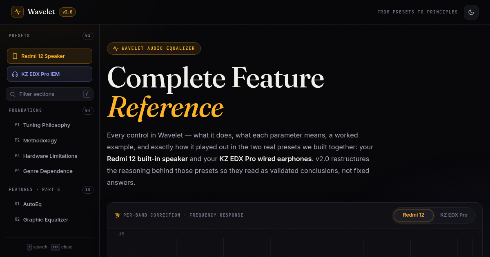

<div align="center">



# Wavelet · Complete Feature Reference

**Signal, dissected.**  
A mastering-console-grade technical reference for the Wavelet Android equalizer.

[](https://nmstudioo.github.io/wavelet_ultimate/)


[Overview](#overview) · [Features](#features) · [Design](#design-system) · [Structure](#repository-structure)

</div>

---

## Overview

This is not a user manual. It is an engineering reference that explains every control in the Wavelet app, the reasoning behind it, and real, validated preset values for the **Redmi 12 built-in speaker** and the **KZ EDX Pro** wired earphone.

> [!IMPORTANT]
> Independent reference. Not affiliated with the Wavelet app or its developer.

| Attribute | Value |
|:--|:--|
| **Format** | Hand-built HTML / CSS / JS |
| **Charts** | Catmull-Rom SVG splines |
| **Themes** | Studio dark + warm paper light |
| **Build step** | None |

---

## Features

- **Interactive frequency-response chart:** Redmi 12 Graphic-EQ curve and KZ AutoEq flat line drawn as smooth splines on a log axis with device toggle.
- **Sticky table of contents:** Scrollspy highlighting, `/`-to-filter search, focus-trapped mobile drawer.
- **Living data:** Headroom meters, cut-depth band charts, and stat counters that animate on scroll.
- **One-click preset dumps:** Copy the exact biquad values to clipboard.

---

## Design System — "Studio Instrument Panel"

Dark slate with cyan accents for data, warm paper for the light theme. The typography is clinical: a geometric sans for UI, a monospace for every number.

| Role | Face |
|:--|:--|
| Display | **Space Grotesk** |
| Body | **DM Sans** |
| Data | **Geist Mono** |

| Token | Dark | Light | Use |
|:--|:--|:--|:--|
| `--bg` | `#0f172a` | `#f8fafc` | Page background |
| `--acc` | `#38bdf8` | `#0284c7` | Charts, active states |
| `--mut` | `#94a3b8` | `#64748b` | Muted text |

---

## Repository Structure

```text
wavelet-reference/
├── index.html          ← the entire reference
├── assets/
│   ├── css/main.css    ← design tokens → components → responsive
│   ├── js/main.js      ← 10 small modules, vanilla ES2020+
│   └── img/favicon.svg
├── .github/workflows/deploy.yml
├── DESIGN.md           ← design decisions, tokens, interactions
└── README.md
```

---

<div align="center">
<sub>Designed &amp; tuned by <b>Noushad M.</b> · © 2026</sub>
</div>
